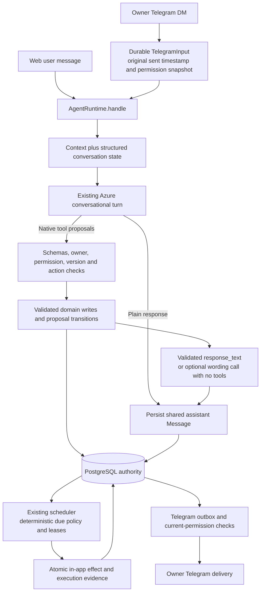
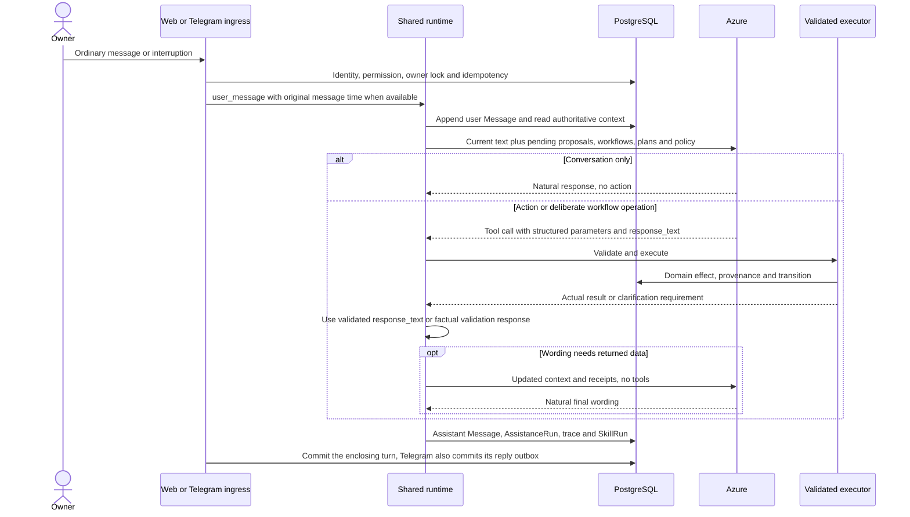
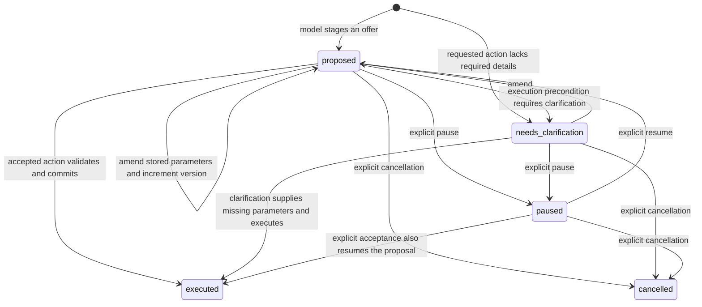
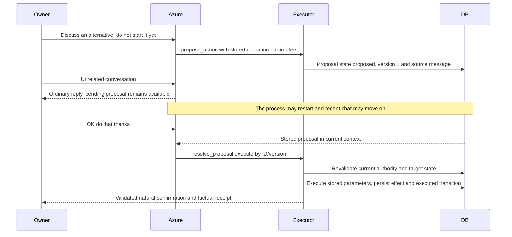
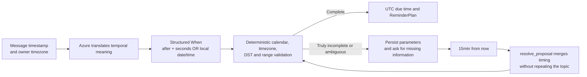
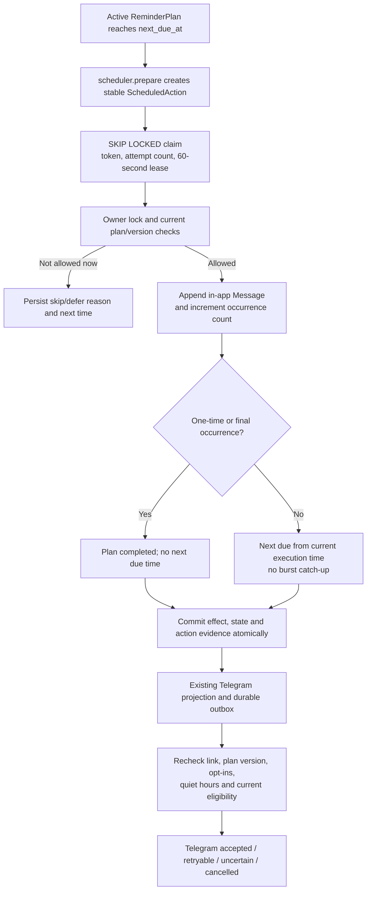
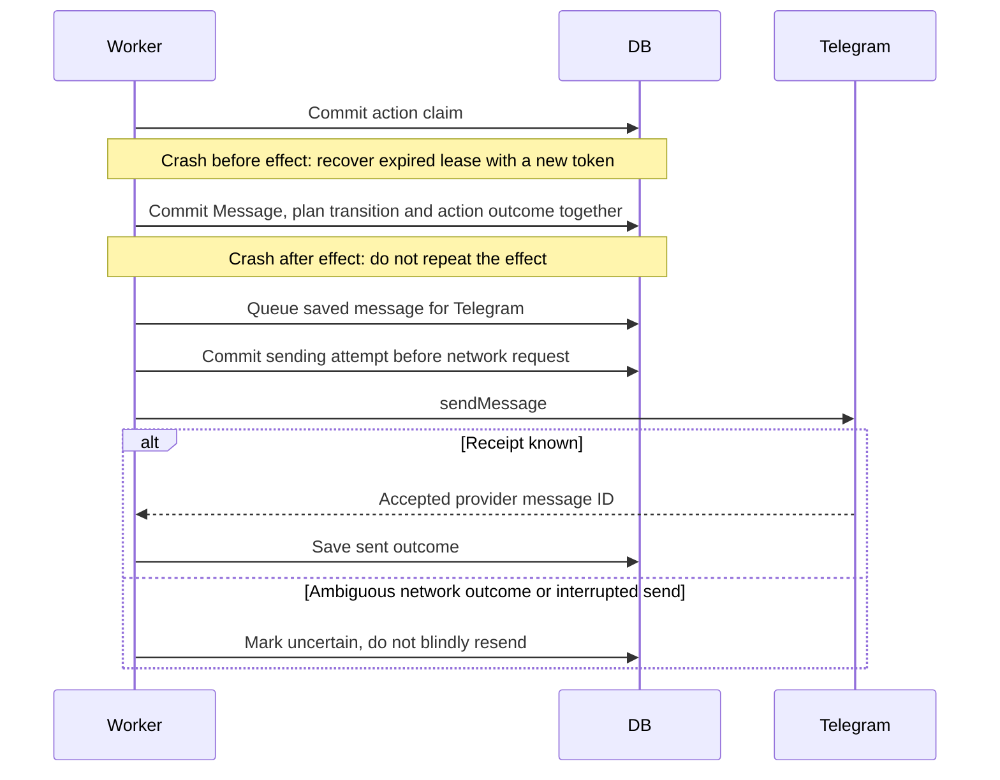
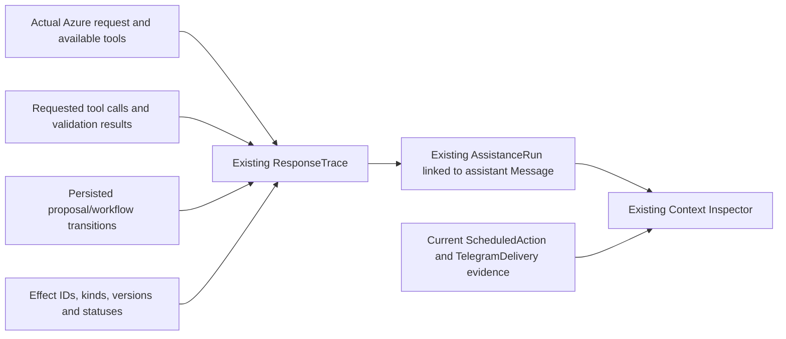

# Conversation and autonomy — Azure interpretation, deterministic execution

This document maps the implemented semantic integration and migration **0014**. Deployment and
acceptance evidence is maintained in [IMPLEMENTATION_STATUS.md](../IMPLEMENTATION_STATUS.md).
The [pre-integration audit](CONVERSATION_AND_AUTONOMY_BASELINE.md) preserves the earlier regex-driven
design for comparison. No Jev, Hermes, Letta or second conversational decision model is introduced.

## 1. Current responsibilities and boundaries

| Concern | Implemented owner |
| --- | --- |
| Authentication and permissions | Existing web session/CSRF boundary and Telegram owner link. Operational writes require the current write grant; Telegram also retains its arrival-time grant. |
| Conversational interpretation and activity selection | Azure in the existing first `contextual_reply` call. Pending activities are supplied as data; they cannot consume a live turn automatically. |
| Context assembly | `context.build_context` plus bounded `continuation.conversation_state`: recent conversation, current records, proposals, reminder plans, reflection/vocabulary state, clocks and delivery policy. |
| Action selection | Native tool calls from that same Azure turn. Ordinary conversation needs no tool or workflow operation. |
| Validation and execution | `execute_tool`, domain schemas and owner-scoped functions. They enforce ownership, permission, versions, state preconditions, timing and occurrence/rate limits. |
| Continuation | `ConversationProposal`: stored allowlisted tool name, arguments, source message, state, version and execution receipt. |
| Reminder/check-in scheduling | `ReminderPlan` plus the existing `ScheduledAction` claim/lease ledger and worker. One-time and recurring plans are distinct from goal commitments. |
| Response generation | Azure's text or tool `response_text`, used after validation; optional second call for wording/data after tools. Backend supplies factual receipts and genuine validation questions. |
| Durable state | Existing PostgreSQL/Neon database, conversation, domain rows, revisions, provenance and transaction boundaries. |
| Observability | Existing `ResponseTrace`, Context Inspector and action/delivery records, with added effect and transition fields. |
| Recovery | Existing owner locks, event keys, stable action keys, leases, bounded retries and Telegram uncertainty handling. |

Web and ordinary Telegram DMs share the same runtime implementation, owner conversation and data.
They are separate process instances: web commits its request transaction; Telegram commits the
shared turn and saved reply parts together. Telegram slash commands remain adapter controls.
Public multi-user access is not implemented. The temporary Modal trial and its expiry remain as
documented in [MODAL_TRIAL.md](../MODAL_TRIAL.md).

Sources: [agent.py](../../backend/app/agent.py), [assistance.py](../../backend/app/assistance.py),
[context.py](../../backend/app/context.py), [telegram.py](../../backend/app/telegram.py).

## 2. A normal turn, including a pending activity

For a live gateway, `AgentRuntime` appends the user message and calls contextual assistance.
There is no reflection-first/vocabulary-second interpretation branch for live messages. The older
deterministic handlers remain only in the no-gateway development path and for explicitly invoked
scheduled/domain operations; they are not the live conversational arbiter.

“Not so great” and “You're not gonna ask how my day went?” therefore reach Azure even when a
reflection or vocabulary activity is open. Azure can engage naturally, pause an activity, record
a genuine reflection, or grade an actual vocabulary answer. The mere presence of a pending row
does not authorize any of those effects.

`manage_workflow` selects a reflection/vocabulary target by owner ID and version. Pause/resume/cancel
are durable. Recording a reflection uses actual owned user-message IDs and retains verbatim source
content; semantic vocabulary grading is an explicit structured `correct`/`incorrect`/`uncertain`
proposal. Counters, review intervals, source ownership and state transitions remain deterministic.

The model handles explicit unhelpful feedback as context too; a keyword-based application response
no longer replaces that conversational turn. Lexical SQL retrieval and security/schema checks still
exist, but they are not the primary interpretation of conversational meaning.

## 3. Durable proposals and acceptance

When offering an action rather than executing a direct request, Azure calls `propose_action` in
the same turn. This stores typed, allowlisted parameters. Missing reminder timing is also retained
as a `needs_clarification` proposal instead of losing its topic/parameters.

`resolve_proposal` merges corrections into stored arguments. Temporal subfield corrections retain
known time/date/timezone fields; changing temporal kind removes incompatible fields. An accepted
proposal invokes one allowlisted domain operation inside the same transaction, records its result
and closes the proposal as executed. Closed proposals do not execute again. Permission is checked
again on acceptance; a proposal is not an authorization grant.

The proposal target allowlist includes reminder creation/update, commitment creation/update,
project/idea capture or correction, and reflection/vocabulary operations. It excludes arbitrary
external calls and recursive proposal execution. The original parameter source and the later
acceptance are linked through provenance and the proposal's stored result.

The model context contains bounded lists (four proposals, six reminder plans, recent workflow
records and current intentions), not an unlimited transcript. Pending proposals are prioritized
over closed ones. Stored parameters survive database/session/process restart; model inference itself
is not a checkpointed continuation stack.
Older proposals/plans can also be selected by a unique owner-scoped title/topic reference. This
resolves stored parameters under the owner/row lock without requiring the user to repeat them;
genuinely ambiguous matches still require clarification.

Source: [continuation.py](../../backend/app/continuation.py).

## 4. Reminder and time semantics

`schedule_reminder` creates a `ReminderPlan`, not a fake commitment deadline:

| Mode | Timing and completion |
| --- | --- |
| `once` | One due time, one occurrence, then completed. A short explicit reminder is permitted from one second; actual arrival also includes model, polling and transport latency. |
| `recurring` | An interval and bounded occurrence count. If the first time is omitted, it is one interval from the message. No deadline is demanded for a focus check-in. |

- Telegram's actual `message.date` is retained as `TelegramInput.message_at` and used for the shared
  Message timestamp. Relative expressions are anchored to that message, not a delayed worker run.
  Older inputs are backfilled from their recorded ingestion timestamp; original platform timestamps
  cannot be reconstructed retrospectively.
- `at 3pm` without a date means the next occurrence in the owner's timezone. A relative eight-minute
  interval is `480` seconds. DST gaps/folds require a valid explicit resolution rather than a guessed
  instant. Structured commitment date-only deadlines retain date-bound granularity.
- Proposals preserve temporal parameters/timezone. An offered relative alternative can explicitly
  anchor to acceptance; a new “15min from now” clarification anchors to the clarification message.
- The universal 15-minute floor is removed, including the old commitment-follow-up constraint/UI.
  Reminder policies are configurable through `MICA_MIN_CHECKIN_SECONDS` (default 60),
  `MICA_REMINDERS_PER_HOUR` (default 12) and `MICA_REMINDERS_PER_DAY` (default 50). Recurring plans
  default to five occurrences and allow at most 100. These are safeguards, not natural-language rules.
- Exact one-time requests default to their requested time even during quiet hours. Recurring plans
  respect quiet hours by default, with an explicit plan-specific override. Telegram notification
  opt-in remains mandatory, and recurring accountability still respects the global check-in setting.
- Legacy `deadline_text` normalization remains for compatibility. The live tool contract prefers
  structured deadlines; unspecified live deadlines are not inferred by scanning incidental words
  such as “by” in “learn by practicing.”

Sources: [temporal.py](../../backend/app/temporal.py), [reminders.py](../../backend/app/reminders.py),
[commitments.py](../../backend/app/commitments.py).

## 5. Deterministic scheduling and delivery

The existing scheduler still owns execution, not Azure. Original commitment check-ins and daily
routines remain supported. Reminder plans use the same action leases, stable keys, bounded retries
and transactional effect guarantees. A one-time plan's automatic completed state permits delivery
of its already-saved final message; an owner correction/cancellation increments its version and
invalidates stale delivery instead.

Pause cancels outstanding plan actions and clears its next execution; the plan retains its parameters.
Resume recomputes recurring timing and uses a fresh version. A paused one-time reminder whose old
time passed needs a new time, not repetition of its topic. Corrections do not revive old action keys.

No additional external-contact authority is inferred from a model response. WhatsApp remains
disabled, and proposal tools cannot authorize it. The original 46-hour Modal window is not extended
by this integration.

## 6. Existing observability, extended

The inspector shows pending conversational state supplied to Azure, actual calls, explicit absence
of tool calls, execution outcomes, persisted effect receipts and workflow transitions. It can also
show current action/delivery evidence for deterministic reminders without pretending there was an
LLM prompt. Historical trace inputs remain separate from current execution records.

There is no LangSmith/Langfuse-style parallel trace store. `saved`/`updated` tool receipts, a committed
in-app effect, provider acceptance, and the owner's actual task completion remain distinct claims.
Natural replies may come from `response_text` inside a native tool call; the application displays
them only after successful validation and adds factual scheduling bounds/receipts.

Sources: [tracing.py](../../backend/app/tracing.py),
[response-context.tsx](../../frontend/app/response-context.tsx),
[continuation_api.py](../../backend/app/continuation_api.py).

## 7. Implemented changes and verification

- Migration `0014`: durable `ConversationProposal` and `ReminderPlan`; workflow state/version on
  existing reflection/vocabulary records; Telegram input timestamps; reminder-plan action linkage;
  lowered legacy commitment-follow-up minimum.
- All live conversational messages now enter Azure, including interruptions and disclosures.
  No added mandatory classifier inference. Existing fallback formatting calls remain bounded.
- Proposed actions persist before acceptance; execution uses stored parameters with current grants
  and optimistic versions. Genuine missing timing survives clarification and process restart.
- One-time reminders and recurring check-ins have separate deterministic semantics and safeguards.
- Existing inspector and Today surfaces expose the additional state; no redundant observability
  or agent framework was added.

Evidence sources: [semantic integration tests](../../backend/tests/test_semantic_conversation.py),
[live Azure smoke](../../backend/tests/live_semantic_smoke.py), existing autonomy/Telegram recovery
suites, and the deployment-specific results in [IMPLEMENTATION_STATUS.md](../IMPLEMENTATION_STATUS.md).
The original runtime is archived in the baseline document rather than represented as the current
live flow. This integration does not imply public multi-user readiness or owner acceptance of the
entire companion experience.
