# Conversation and autonomy: historical pre-semantic-integration baseline

This is the preserved audit of revision `84c710d`, before the semantic integration. Its routing
diagrams are historical, not the current live design. See
[the current architecture](CONVERSATION_AND_AUTONOMY.md) for migration `0014` and the implemented
Azure-led runtime. Line-numbered source references below describe the `84c710d` snapshot.

**Repository snapshot:** `84c710d` on `feat/functional-autonomy`; latest application change
`8b8bb7b`. This map was checked against source, model definitions, migrations and existing tests,
not inferred from the product specification or earlier summaries.

**Scope:** a documentation audit. No conversational routing, schemas, services or deployed settings
were changed for this document. Section 11 records the changes already implemented over the recent
autonomy work. Future proposals are explicitly excluded from the implemented diagrams.

Deployment statements below describe the checked-in deployment code and the recorded personal
rollout, not a new live-service health check. The recorded Modal trial ends **2026-10-30 09:54:34 UTC**;
the code still exists after that hosting window ends. See [the trial runbook](../MODAL_TRIAL.md).

## Contents

1. [System boundaries and responsibility map](#1-system-boundaries-and-responsibility-map)
2. [Normal incoming conversation](#2-normal-incoming-conversation)
3. [Interpretation, routing and pending workflows](#3-interpretation-routing-and-pending-workflows)
4. [Context assembly and response generation](#4-context-assembly-and-response-generation)
5. [Tool invocation and result](#5-tool-invocation-and-result)
6. [Rejection and clarification](#6-rejection-and-clarification)
7. [Scheduled autonomous action](#7-scheduled-autonomous-action)
8. [Interruption, resumption, retries and recovery](#8-interruption-resumption-retries-and-recovery)
9. [Delegated responsibility workflow: implemented but disabled](#9-delegated-responsibility-workflow-implemented-but-disabled)
10. [Durable state and evidence](#10-durable-state-and-evidence)
11. [Implemented evolution and absent components](#11-implemented-evolution-and-absent-components)
12. [Verification references](#12-verification-references)

## 1. System boundaries and responsibility map

### Current component map

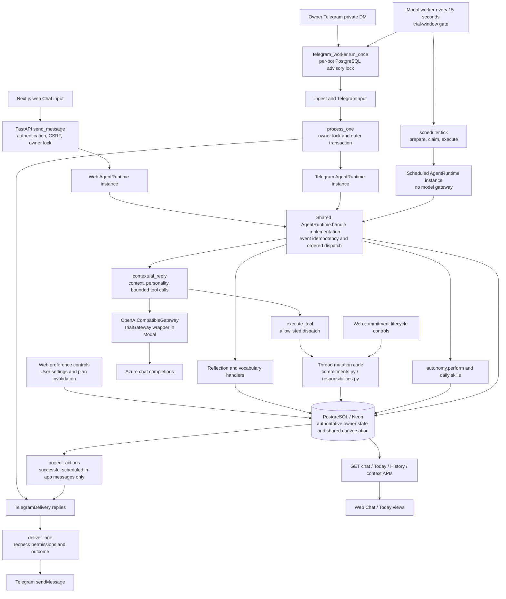

The shared runtime is **a class and implementation, not one shared in-memory object**. The local
FastAPI process, Telegram worker and scheduler instantiate it separately. Durable continuity comes
from the same PostgreSQL database, owner ID and `ConversationSession`, not process memory.

The diagram's mutation box groups existing code, not a new service. Commitment lifecycle controls call
`commitments.change(..., trusted=True)` directly; they do **not** call `execute_tool` or
`AgentRuntime.handle`. Similarly, delegated channel replies use a separate responsibility service
(section 9). The runtime's “single entry point” docstring is accurate for routed conversational and
personal scheduled events, not for every mutation anywhere in the application.

### Component responsibilities

| Responsibility | Actual owner of the behavior | Boundary / qualification |
| --- | --- | --- |
| Context assembly | [`context.build_context`](../../backend/app/context.py#L76-L619) | SQL-based, owner-scoped lexical/link retrieval; returns payload plus selection manifest. Pending deterministic handlers perform their own SQL reads instead. |
| Conversational interpretation | [`assistance.contextual_reply`](../../backend/app/assistance.py#L383-L622), Azure through [`gateway.py`](../../backend/app/gateway.py) | Model returns ordinary text and/or native tool proposals. It cannot directly mutate the database. |
| Intent classification and routing | [`AgentRuntime.handle`](../../backend/app/agent.py#L231-L335), [`lifecycle_message` / `explicit_followup`](../../backend/app/commitments.py) | Ordered conditions, regexes and pending-row checks. There is no separate general live intent-classifier service. |
| Deterministic development classification | [`StateExtractor.extract`](../../backend/app/runtime.py#L47-L121) | Used when `gateway is None`; it is **not** the normal live Azure intent classifier. |
| Workflow selection | The branches in `handle`; event-kind dispatch; pending skills' selection queries | Reflection before vocabulary; otherwise contextual assistance in live mode. No workflow registry or generic orchestration engine. |
| Workflow transitions | [`daily.py`](../../backend/app/daily.py), [`vocabulary.py`](../../backend/app/vocabulary.py), [`commitments.py`](../../backend/app/commitments.py), [`responsibilities.py`](../../backend/app/responsibilities.py) | Separate domain-specific rules and durable records; no unified workflow-state table. |
| Tool selection | Azure's first response, constrained by [`tool_schemas`](../../backend/app/assistance.py#L117-L167) | Backend chooses which schemas are available from the current permission, then validates every returned call. |
| Tool execution | [`execute_tool`](../../backend/app/assistance.py#L170-L335) and its domain functions | Allowlist, schemas, ownership, source-text and state/version checks. The model receives neither SQL nor an ORM session. |
| User-facing response | Azure text; application clarification/failure/receipt strings; deterministic skill templates | [`personality.py`](../../backend/app/personality.py) styles the live model prompt; it grants no action authority. |
| Durable persistence | [`models.py`](../../backend/app/models.py), [`persistence.py`](../../backend/app/persistence.py), caller-owned SQLAlchemy transactions | Ordered shared messages, domain records, provenance, revisions and separate action/delivery ledgers. |
| Scheduling | [`scheduler.py`](../../backend/app/scheduler.py), [`autonomy.py`](../../backend/app/autonomy.py), [`plan_next`](../../backend/app/commitments.py#L186-L225) | Deterministic due checks and authorization; current personal scheduled actions do not invoke an LLM. |
| Retry/recovery | Event keys, action leases, Telegram inbox/outbox, bridge journal; process runners | Each subsystem has different guarantees; section 8 separates them. |

## 2. Normal incoming conversation

### 2.1 Web message

Sources: [`Chat.deliver`](../../frontend/app/chat.tsx#L32-L45),
[`main.send_message`](../../backend/app/main.py#L394-L436),
[`mutation_guard`](../../backend/app/main.py#L188-L217),
[`AgentRuntime.handle`](../../backend/app/agent.py#L190-L222).

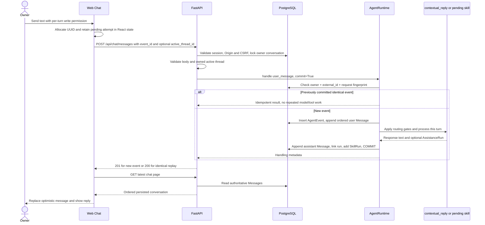

- `ChatIn` limits content to 4,000 characters. The frontend trims text and clears the write checkbox
  for the next new message. `allow_memory_write` controls structured writes, **not raw chat retention**.
- The HTTP POST returns handling metadata, not streamed model tokens or the assistant message body.
  The frontend subsequently fetches messages. Visible Chat/Today also refresh every 10 seconds in
  [`page.tsx`](../../frontend/app/page.tsx), so external conversation updates can appear.
- Authentication/CSRF/body/ownership errors stop before ordinary processing. Conflicting event
  fingerprints or concurrent mutations return 409; selected PostgreSQL concurrency SQLSTATEs are
  rolled back and translated to retryable 409 responses.
- The fingerprint binds owner, event kind/content/timing/conversation and applicable permission or
  active-thread fields. Same key with different input is not a valid retry. Legacy fingerprint
  upgrade support is explicitly implemented in `_idempotent_result`.
- If POST succeeded but GET failed, the browser's pending attempt records `accepted=True` and retries
  reconciliation without repeating POST. If POST outcome is uncertain, it reuses the same event ID
  and payload. This pending attempt is **React state**, not a durable workflow or persisted offline
  queue; a page reload does not retain the pending attempt itself.

### 2.2 Telegram message

Sources: [`telegram_worker.run_once`](../../backend/app/telegram_worker.py#L14-L36),
[`telegram.ingest`](../../backend/app/telegram.py#L97-L244),
[`process_one`](../../backend/app/telegram.py#L247-L308),
[`deliver_one`](../../backend/app/telegram.py#L394-L450).

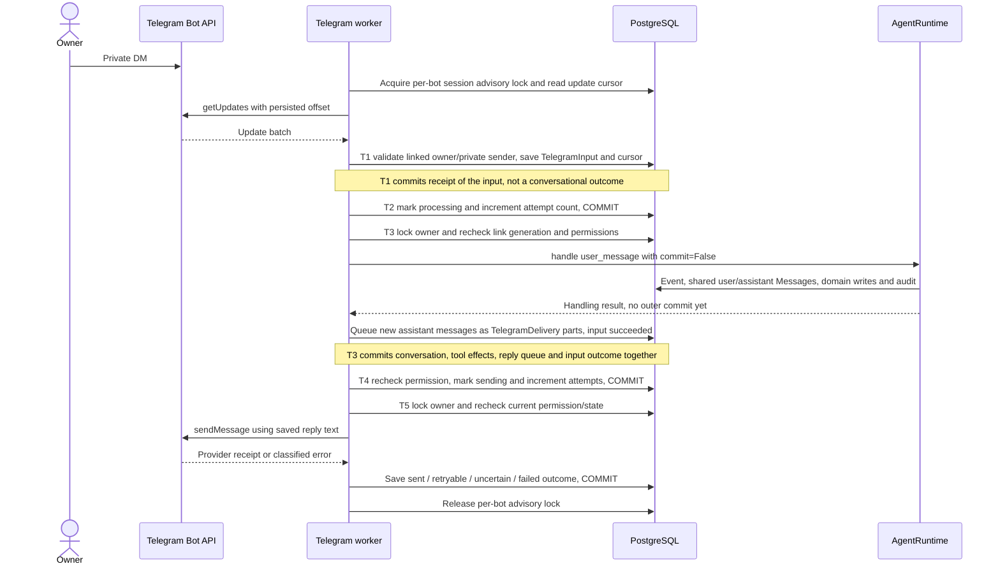

Before ordinary DM processing:

- Only private messages whose positive numeric sender ID equals the private chat ID are eligible.
  Bot messages, groups and unlinked senders are ignored. The link must belong to `User.username ==
  "owner"`; it does not provision accounts or expose multi-user access.
- `TelegramBot.next_update_id` advances in the same ingestion transaction as accepted inbox rows.
  The inbox's `(connection_id, update_id)` uniqueness and event key
  `telegram:{bot_id}:{update_id}` provide different layers of deduplication.
- `/start <code>` consumes a hashed, expiring single-use web invitation. `/start`, `/status`, `/help`
  and `/stop` for a linked owner are **adapter commands**. They bypass AgentRuntime, queue fixed
  acknowledgements and do not create ordinary conversation Messages. `/stop` pauses Telegram
  proactive delivery, not the underlying commitment or in-app scheduler.
- Empty/oversize/unsupported text or queue/rate limits produce a fixed linked-owner reply instead
  of a model call. The limits are 20 pending/processing inputs and 60 accepted inputs per hour.
- Effective write permission is **ingestion-time grant AND current link grant**. Relinking/revoking
  changes the generation; stale queued inputs are skipped. There is no `active_thread_id` passed
  from Telegram and no Telegram reply-to-message routing into a particular pending workflow.
- One cycle processes at most five inputs, projects up to 50 eligible scheduled actions per linked
  owner and attempts up to 20 queued delivery parts. Text is split into at most 3,500 UTF-16 units per
  part, sent as plain text without link previews. These caps do not imply one database transaction
  for the whole cycle.

### 2.3 Do web and Telegram share runtime and state?

**Yes for ordinary conversation, with these concrete qualifications:**

| Shared | Different |
| --- | --- |
| Same `AgentRuntime.handle`, `contextual_reply`, tool registry, domain validators and personality code | Separate instances/processes; web invokes through HTTP, Telegram through a persisted inbox |
| Same owner ID, one `ConversationSession` per owner, same ordered `Message` rows | Web has per-turn write permission and optional active-thread selection; Telegram has a revocable ongoing grant plus arrival-time permission snapshot |
| Same commitments, projects/ideas, journals, vocabulary, pending reflection/review rows and provenance | Web uses `commit=True`; Telegram uses `commit=False` inside the adapter's effect/outbox transaction |
| Same authoritative PostgreSQL database when configured as in the recorded Neon cutover | Modal uses `TrialGateway` / `TrialTelegram` expiry guards; local web uses the configured base gateway |
| Telegram-generated ordinary responses are visible through the web chat/history APIs | Ordinary web replies are not broadcast to Telegram; adapter commands/acks are not ordinary shared chat Messages |

Identical text need not yield identical behavior: permissions, active-thread selection, current
pending rows, clock and available context can differ. Database identity is a deployment condition:
pointing services at different `DATABASE_URL`s would create separate state despite sharing code.

## 3. Interpretation, routing and pending workflows

### 3.1 Actual routing priority

The live routing gates are evaluated **before** `build_context` or an LLM call. There is no initial
LLM classification step deciding whether every message belongs to a workflow.

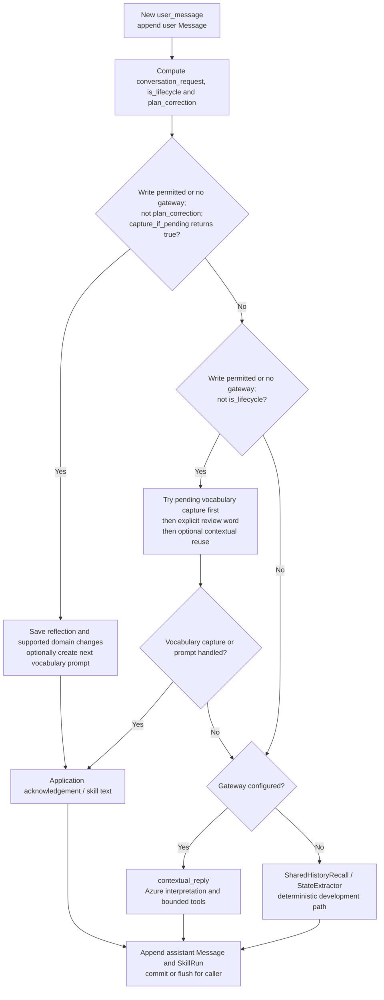

The predicates in [`agent.py`](../../backend/app/agent.py#L231-L299) are not interchangeable:

- `conversation_request` requires a live gateway and either `explicit_followup(text)`, a trailing
  `?`, or the small full-match greeting regex (`hi|hello|hey`, optionally one name/word).
- `is_lifecycle` requires a live gateway and either that predicate or
  [`lifecycle_message`](../../backend/app/commitments.py#L63-L75): selected deadline, availability,
  plan-edit, completion and pause/cancel/resume/reopen phrases.
- `plan_correction` is `conversation_request` OR a lifecycle match containing one of the specific
  plan-edit words listed in the runtime. It suppresses reflection capture. `is_lifecycle` suppresses
  vocabulary capture. **A plain completion can still be consumed by reflection**, because matching
  completion does not by itself make `plan_correction` true.
- The optional vocabulary `contextual_reuse` text does not set `vocabulary_handled`. If the live
  contextual branch is eligible, it takes precedence over that optional text.
- With no gateway, the live bypass predicates are false. The deterministic extractor/recall branch
  has separate behavior. A provider outage in live mode does not silently switch to the development
  `DeterministicModel`; it produces the application failure response described in section 5.

### 3.2 What constitutes a pending workflow?

| Workflow | Pending state and selection | Consuming the reply | Response |
| --- | --- | --- | --- |
| Evening reflection | Latest owner `ReflectionPrompt(status="awaiting")`, current policy, `created_at >= now - 12h`, selected under lock | `capture_if_pending` parses narrow clause patterns, stores the original text in `JournalEntry`, links source message/event, marks the prompt completed, and versions/replans affected commitments | Fixed reflection acknowledgement, optionally followed by a vocabulary question; no Azure generation for a handled reflection |
| Vocabulary review | Latest owner `VocabularyAttempt` whose `user_answer IS NULL`; ordinary pending lookup has no age filter | Save a bounded answer/sentence; exact normalized definition is correct, a small explicit failure set is incorrect, everything else is ungraded | Deterministic success/failure/uncertainty text |
| Vocabulary self-correction | Explicit `self-correction:` prefix selects latest **answered** attempt reviewed within 24h | Exact accepted definition can repair the latest grade without replacing the original answer; repeat correction of an already-correct attempt is a no-op response | Deterministic correction result |
| Personal accountability | An open/in-progress/waiting Commitment with follow-up policy and `next_relevant_moment` | Incoming text is interpreted by the live tool path unless another eligible handler consumes it; the check-in does not create a generic pending-answer slot | Model plus receipts, or the selected pending skill's text |
| Delegated responsibility | `Responsibility.state`, approved scope, next action, linked channel messages | Dedicated `receive`/`interpret` pipeline; not the owner chat pending-handler chain | Domain transitions and owner attention messages; see section 9 |

Reflection behavior is specifically **not** a general semantic answer detector. Once the runtime
allows capture and a fresh prompt exists, `capture_if_pending` stores a journal even when no clause
matches its extraction patterns. Ambiguous completion references then leave structured commitments
unchanged, but do not necessarily produce a clarification question. `allow_episode` controls the
additional derived Episode, not whether the raw journal is saved. If a journal already exists for
the prompt date, the prompt is linked/completed and capture returns false.

Vocabulary uncertainty also has a subtle transition: the first ungraded answer is saved as
`user_answer != NULL` with `correct=None`. Despite the response inviting restatement, an ordinary
next message is not automatically rebound to that attempt; the explicit self-correction path is
the implemented repair route. Mastery follows correct recall counts: developing, familiar at two,
mastered at four; incorrect recalls schedule one day, first correct two days, familiar seven days.

Sources: [`EveningReflectionSkill`](../../backend/app/daily.py#L374-L765),
[`VocabularyLearningSkill`](../../backend/app/vocabulary.py#L160-L348).

## 4. Context assembly and response generation

For an eligible live conversational turn, `contextual_reply`:

1. Calls `build_context` after the current user Message has been appended. The context can therefore
   contain that message as well as the separate current-turn prompt.
2. Loads profile name/temperament, the UTC/local clock and global check-in preference. The profile's
   companion name remains data; only an allowlisted temperament accent affects system instructions.
3. Selects up to four recent messages **strictly after `User.context_reset_at`**, subject to budgets.
4. Performs deterministic owner-scoped SQL lexical/link retrieval for current Threads/projects/ideas,
   Commitments, Episodes and Journals. Active-thread relationships and matched responsibilities add
   relevance. Selected lifecycle words also include up to six current commitment IDs as candidates.
5. Adds bounded provenance references and relevant explicit assistance feedback. Corrected journal
   text supersedes old derived summaries. Revisions are audit history, not current-state retrieval.
6. Produces a `ContextBundle` and metadata-only selection manifest. Defaults: **12,000 serialized
   context-payload characters**, 1,500 per record, at most 12 included entries (including profile and
   recent messages), up to 40 candidates per type, three sources per record and 24 query terms.
   This is not a 12,000-character cap on the entire prompt: instructions, current text and tool
   schemas are additional inputs.

This is lexical retrieval, not embeddings/vector search. `ReflectionPrompt`, `VocabularyAttempt`
and `ScheduledAction` histories are not independently injected as workflow-state objects into the
model context; the deterministic handlers inspect their own tables, while relevant messages and
current commitment fields can convey some of that history.

`build_system_prompt` combines operational rules with `compose_system_prompt` and
`companion-voice-v1`. For recent relevant unhelpful feedback, `contextual_reply` can return a fixed
acknowledgement without a model call, except for its listed factual-change words. This is another
separate heuristic—not a suspended clarification workflow.

User-facing output can thus originate from:

- First model response, or the second response after successful tools.
- Backend clarification questions, budget/failure messages and appended server receipts.
- Reflection/vocabulary/daily/check-in templates.
- The deterministic development adapter or history-recall skill when no live gateway is supplied.

[`ResponseTrace`](../../backend/app/tracing.py) captures actual request bodies, returned visible
content, usage and tool execution results. It does not reconstruct historical prompts or store an
internal reasoning trace. Private trace snapshots are distinct from general metadata-only manifests
and diagnostics; [`response_context`](../../backend/app/main.py#L551-L605) exposes them only through
the owned-message inspection boundary.

## 5. Tool invocation and result

### Registry and execution ownership

| Tool | Executor / durable result |
| --- | --- |
| `retrieve_context` | Returns the already-selected bounded context; no write |
| `get_commitments` | Reads up to five owned current commitments, or title-substring matches, bounded to 6,000 serialized characters; expands allowed IDs |
| `save_project`, `save_idea` | Thread/project/idea plus revision and provenance; model-authored non-verbatim summaries retain inference status |
| `update_thread` | Owned/selected Thread, versioned CAS, revision and provenance |
| `create_commitment` | Validated intention, timing/policy, next-check metadata, CommitmentRevision and provenance |
| `update_commitment` | Reference resolution, state/source/version validation, CAS, correction evidence, cancellation/replanning |
| `draft_responsibility` | Draft delegated workflow and underlying Commitment; explicitly does not authorize external contact |

Write tools are omitted from advertised schemas without write permission, and `execute_tool`
rechecks permission if the model nevertheless proposes one. Tool schemas reject unexpected fields;
owned/selected-ID checks and source-text guards are enforced by the relevant domain function.
Reads occur before the write sensitivity check. Validators differ by domain; this is not a claim
that every field has the same validation or that all handlers share one strict schema base class.

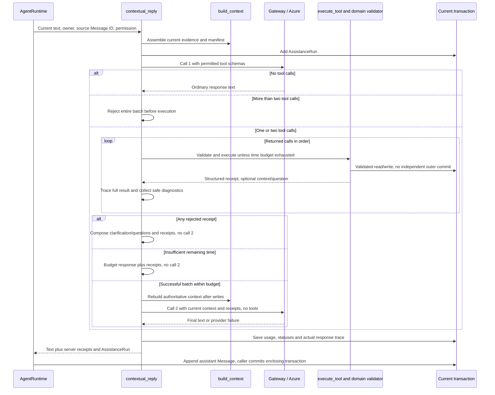

The application executes at most two tool calls from the first response. There is **no recursive
tool/reasoning loop**: call 2 has an empty tool list; unexpected calls there are not executed.
The second prompt is rebuilt from authoritative post-tool state and structured receipts, rather
than replaying stale pre-correction context/tool arguments.

The assistance phase checks a 35-second operation budget before tools and before a second model
call; the second call needs at least 15 seconds remaining. It is not a hard end-to-end database/HTTP
timeout, and initial context assembly occurs before that timer starts. The gateway separately uses
a killable subprocess with a wall-clock limit of at most 15 seconds per call and bounded response
size. See [`gateway.complete`](../../backend/app/gateway.py#L240-L319).

**Result and commit distinctions:**

- A returned rejection is not a thrown transaction error. A later rejected call does not roll back
  an earlier successful call in the same batch. Audit/revision activity can also exist on a rejected
  path. Receipts must be read per action.
- A caught `GatewayError` after a successful write records `AssistanceRun.execution_status="failed"`
  and an application failure message **with completed-write receipts**. The caller can still commit
  those writes. An uncaught exception instead causes the outer transaction to roll back.
- Tool `saved`/`updated` means the domain function has staged/validated the change; durability follows
  the enclosing commit. `delivery="in_app"` in a commitment-tool receipt means a check is planned,
  not that a Telegram message has already been sent.

## 6. Rejection and clarification

The live commitment path can reject tentative intent, ambiguous timing, an unknown/ambiguous target,
unsupported delegated mutation, missing follow-up wording, unconfirmed completion or stale versions.
`commitments.reject` returns `{status: "rejected", reason, question}`. Other tool failures may return
only a reason (unknown tool, schema error, permission or sensitive source).

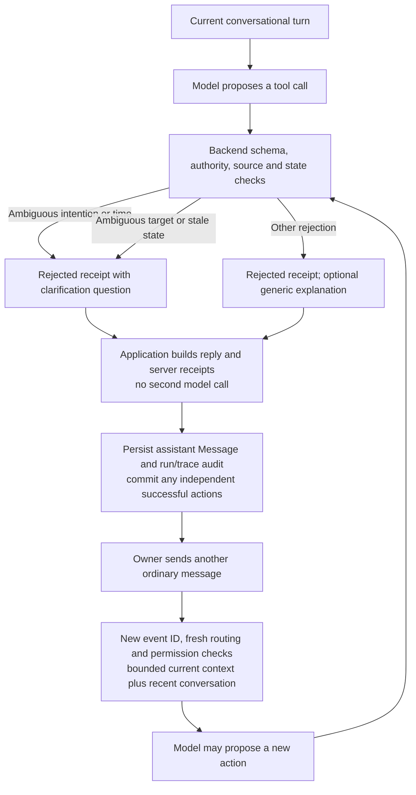

There is **no durable pending-tool proposal, clarification ID, missing-slot record or continuation
token** automatically filled by that answer. The question survives as a Message/private trace;
the next turn is interpreted again using whatever current context is available. The owner may
need to restate the target or deadline. Source-text validators use the current utterance, and the
web checkbox must be granted for the new write turn. An API lifecycle rejection differs: its
`commitment_control` event is committed with rejected status, then the endpoint returns 409/422.

For example, an ambiguous `create_commitment` date is rejected **before creating a commitment** in
the live tool path. In the legacy no-gateway extractor path, the code can instead save a commitment
with `ambiguity` set and no guessed deadline, then ask a question. Those are different implemented
paths, not evidence of a universal clarification-resume engine.

Sources: [`commitments.create/resolve/change`](../../backend/app/commitments.py#L342-L595),
[`assistance` rejection handling](../../backend/app/assistance.py#L487-L534),
[`autonomy_api.lifecycle`](../../backend/app/autonomy_api.py#L182-L250).

## 7. Scheduled autonomous action

### 7.1 From durable intention to effect

Creating/editing a commitment stores `next_relevant_moment`; it does **not** immediately create every
future `ScheduledAction`. `scheduler.prepare` materializes a stable action when due, or records a
stable skip when no permitted next check exists. Routine occurrence keys include kind, local date
and preference version; daily skill rows separately deduplicate by owner/date/policy.

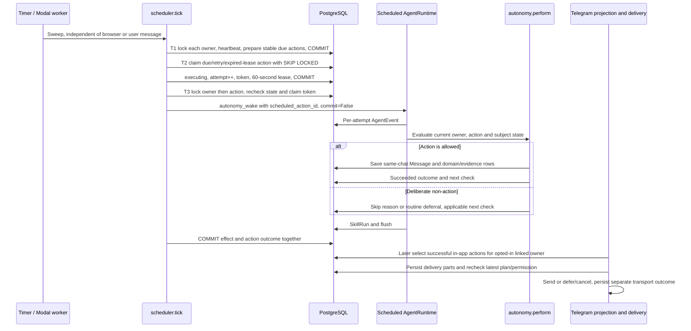

`autonomy.perform` rechecks kind, due time, preference version, owner opt-ins and, for personal
commitments, existence/deletion, subject version, active state, temporal ambiguity and follow-up
limits. Quiet hours and availability can defer the next check. Personal check-ins are capped at
three successful in-app interventions per local day, plus each commitment's own maximum.

- Personal check-ins use a deterministic template from current title/status/deadline/bound, purpose,
  next action and blockers. The same transaction stores the Message, Reminder, provenance, outcome
  and next-check metadata. No model decides or words these scheduled interventions.
- Morning briefing reads current commitments/threads, yesterday's unfinished IDs, recent episodes
  and vocabulary; it saves `DailyBriefing`, an assistant Message, Episode and provenance.
- Evening start saves an awaiting `ReflectionPrompt`, its fixed question Message, Episode and
  provenance. The later reply is a separate user-message transaction (section 3).
- Per-plan defaults are a 24-hour cadence and three follow-ups. Validated cadence is 15 minutes–one
  week, maximum follow-ups 0–10. `plan_next` uses a minimum 15-minute lead, initial deadline/effort
  adjustment and an eight-day, 15-minute-step availability search. A completed/cancelled/paused or
  opted-out item has no permitted planned check.
- Quiet routine deferral reuses the action as pending with `retry_at` and decrements the consumed
  attempt; a quiet/unavailable commitment check records a skip and moves the commitment's next check.

### 7.2 Action states and recovery

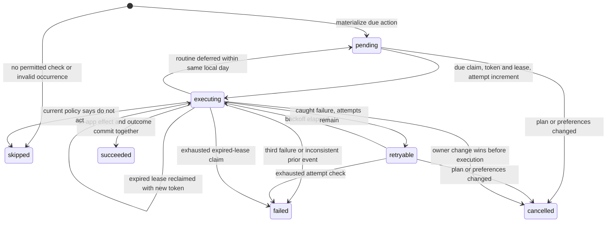

Three attempts maximum; failure backoff is 60 seconds after attempt one and 120 seconds after
attempt two. A third failure is terminal (the code also stores a retry timestamp, but `failed` is
not claimable). An exhausted candidate can end that sweep's claim loop; another sweep checks later
work. Changing a plan creates new version/due keys rather than resurrecting failed/cancelled rows.

The stable action key, row locks, token recheck and **single in-app effect transaction** provide
deduplication for that database effect. Each claim uses a new token, so its `autonomy:{id}:{token}`
AgentEvent key is per attempt; event-key reuse alone is not the scheduler's deduplication mechanism.

### 7.3 Other implemented triggers are separate paths

[`POST /api/events/scheduled`](../../backend/app/main.py#L1827-L1881) is an authenticated manual event
boundary, used by Today controls/tests. It validates supported kinds and catch-up windows, then
calls the runtime directly without the new action claim/lease pipeline. Explicit manual routines
do not require the autonomous opt-ins; daily logical deduplication still applies.

- `morning_briefing` / `morning_trigger` and `evening_reflection` use the daily skills directly.
- `vocabulary_review` invokes `VocabularyLearningSkill.prompt`.
- `commitment_check` uses the older [`ProspectiveReminderSkill.run`](../../backend/app/prospective.py#L310-L466):
  fair-cursor batches of 100 active unambiguous commitments, urgency/relevance rules, a separate
  `m3-v1` Reminder key, and in-app output. It is not the new opt-in/quiet-hours policy and is not
  automatically invoked by the Modal personal scheduler.
- `dormancy_scan` is accepted by that API but has **no corresponding work branch in `handle`**;
  it currently records the event/SkillRun, not an implemented dormancy scan.

Only successful `ScheduledAction` messages are selected by the proactive Telegram projector.
Ordinary manual scheduled-event output does not automatically become such a delivery.

## 8. Interruption, resumption, retries and recovery

### 8.1 Conversational interruption of a pending workflow

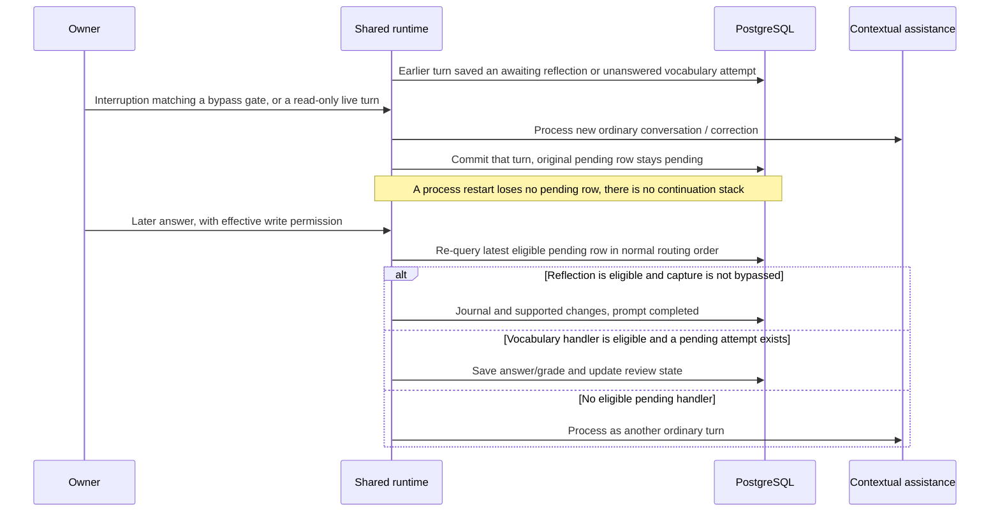

“Resumed” here means **a new event finds an existing eligible domain row**, not restoration of an
LLM stack or replay of an earlier program counter. Reflection eligibility expires after 12 hours;
the old row need not be marked expired. Vocabulary's ordinary unanswered lookup has no equivalent
age cutoff. A newer pending row can win selection, and reflection has priority over vocabulary.
There is no reply-to routing or generic guarantee that an arbitrary off-topic message will bypass
capture: messages outside the explicit gates can still be consumed by a pending handler.

### 8.2 Pausing and resuming a commitment

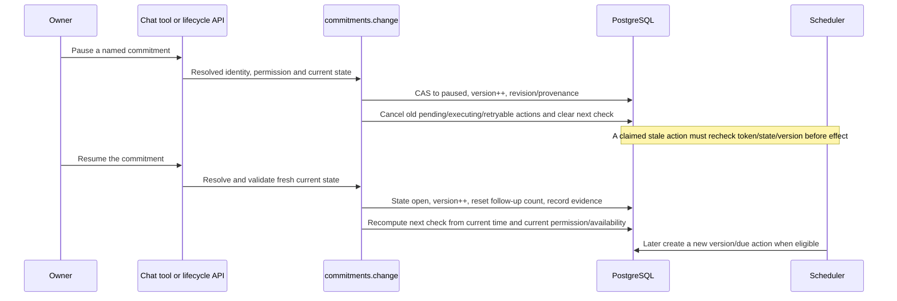

`resume` sets **open**; it does not restore a remembered previous `waiting`/`in_progress` state.
Terminal commitments require explicit reopening for a return to active work. The backend's action
map is `complete → completed`, `pause → paused`, `cancel → cancelled`, `resume/reopen → open`;
additional guards and the trusted UI identity path determine which requests are accepted.
The reflection/legacy paths also use the older `complete` literal, which is treated as terminal.

Pausing the commitment is distinct from disabling its `followup_enabled` flag, disabling global
check-ins, or using Telegram `/stop`. A state resume does not itself turn an explicitly disabled
follow-up flag back on. Replanning preserves purpose/criteria unless supplied as changes; it is
bounded date/availability/next-action adjustment, not a general goal-decomposition planner.

### 8.3 Failure and retry boundaries

| Interruption point | Durable state | What actually resumes |
| --- | --- | --- |
| Web POST result lost after commit | Event fingerprint, messages and effects already committed | Same-ID retry returns idempotently; UI fetches conversation. No repeated inference/tools. |
| Uncaught exception before conversational transaction commits | Enclosing transaction rolls back | A valid retry starts the turn again. Inference may repeat if its earlier result was never committed. |
| Tool rejection or caught provider error | Application returns a response and commits its actual receipts/state | Not a suspended turn. A later clarification is a new message; successful earlier writes are not automatically retried. |
| Telegram process dies after ingress | Inbox and cursor committed | Pending/processing input is selected again, with at most three processing attempts. |
| Telegram process dies before effect/outbox commit | Processing attempt recorded, effect transaction rolled back | Re-run shared runtime; uncommitted inference can repeat. |
| Telegram process dies after effect/outbox commit | Input succeeded; shared Messages and queued replies committed together | Deliver the saved reply, not another model/tool execution. |
| Scheduler dies after prepare | Stable pending action exists | A later worker claims it. |
| Scheduler dies after claim or before effect commit | Executing action and lease persist; effect transaction rolls back | Reclaim after lease expiry, increment attempt, recheck authoritative state and token. |
| Scheduler dies after effect commit | Action succeeded and in-app Message committed | Same stable action is not executed again. |
| External Telegram send times out or process dies while sending | Outcome may be unknown | Mark uncertain; do not blindly resend. Owner can inspect Telegram and the saved web reply. |
| Explicit Telegram rate-limit rejection | Saved reply and retry timestamp | Retry delivery after provider delay, up to three send attempts; no repeated model/tool work. |
| Owner revokes/relinks Telegram | Generation changes; pending inputs/deliveries invalidated | A new link does not resurrect old work. Current generation/recipient is rechecked before effects/sends. |

Telegram's external send is deliberately outside the atomic conversation transaction:

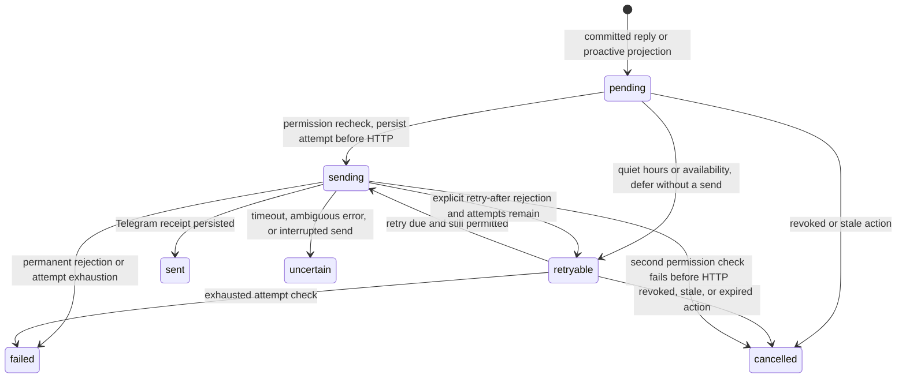

`uncertain` is not an automatic retry state. Recovery marks leftover `sending` rows uncertain while
holding the per-bot advisory lock. `sent` means Telegram accepted the message, not that the owner
read it. Proactive delivery additionally rechecks plan/preference versions, active status, opt-ins,
availability and quiet hours; actions older than two hours are stale. Quiet/availability deferral
does not consume another network-send attempt. The second pre-send permission check can cancel
instead of defer if eligibility changes between the two delivery transactions.

### 8.4 Host restart and trial expiry

[`deploy/modal_trial.py`](../../deploy/modal_trial.py) schedules one worker every 15 seconds. It first
calls the deterministic personal scheduler, then Telegram `run_once` with a live `TrialGateway`.
The worker has one maximum container and no Modal-level automatic retries; a later scheduled
invocation is the retry opportunity, supplemented by the database mechanisms above. A return
status of `ok` or a fresh heartbeat is not proof that every underlying action succeeded.

[`cloud_trial.py`](../../backend/app/cloud_trial.py) gates the trial window and guards new model/send
calls. The separate minute-scheduled expiry function stops only its own Modal app. It does not
delete PostgreSQL state. These are checks at entry/call boundaries, not a universal transactional
expiry: an already-started database transaction or network request may finish or become uncertain.
The authenticated `inspect_runtime(probe_only=True)` diagnostic deliberately uses the base gateway
for a manual connectivity probe; it is not the ordinary scheduled conversational path.

The local scheduler CLI loops every 10 seconds; the local Telegram CLI sleeps one second between
cycles, with an additional five-second failure delay. The recorded cloud trial disables those local
background workers while preserving optional local web/API clients of the same database.

## 9. Delegated responsibility workflow: implemented but disabled

The repository also contains a separate channel-neutral responsibility subsystem and a Node/Baileys
WhatsApp bridge. The personal rollout records WhatsApp as disabled; the Modal worker does not invoke
`operations_worker`. The following is an implemented code path, **not an assertion of active contact**.

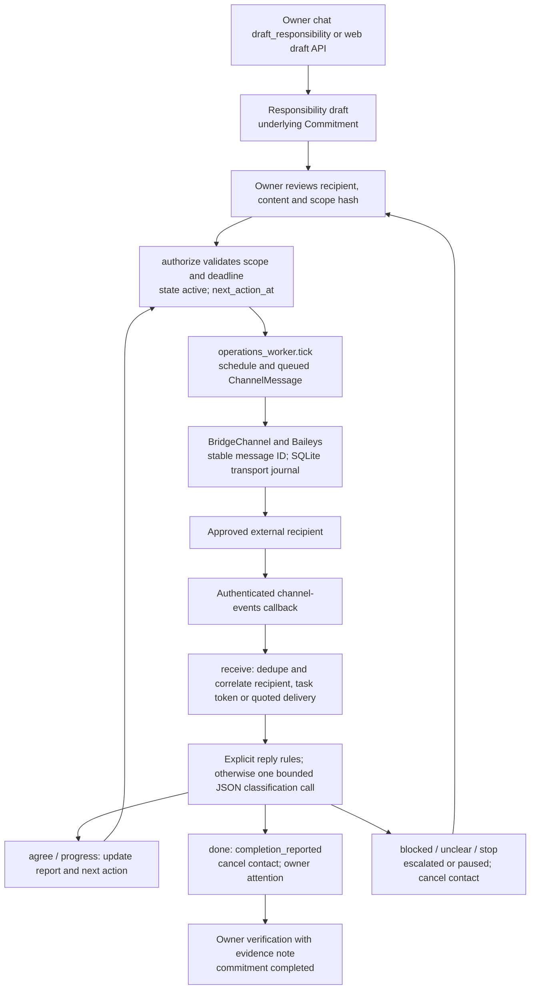

Key distinctions:

- This inbound callback calls `responsibilities.receive`, not `AgentRuntime.handle`.
  [`interpret`](../../backend/app/responsibilities.py#L559-L610) is a real bounded classifier here:
  explicit STOP/AGREE/PROGRESS/DONE/BLOCKED rules first, then one model call returning validated JSON
  with an exact quoted substring. It has no tools and does not generate the owner-chat reply.
- `ChannelMessage`, `ResponsibilityEvent`, manually created AgentEvents and optional same-chat owner
  attention Messages are the evidence. External recipient text is not an ordinary owner user turn.
- Ambiguous correlation escalates for owner inspection; reported completion is not verification.
  Replies to paused/closed responsibilities are retained without reactivating contact.
- Pause/cancel revokes approval and cancels queued messages. Resumption requires fresh explicit
  authorization, valid current scope, future deadline and resolved failed/uncertain delivery.
- The operations sender has up to five retry attempts for retryable channel errors and stable IDs
  shared with the bridge. The bridge's private SQLite journal records outgoing intent **before**
  transport, replays recorded outcomes for the same ID/content, and marks interrupted sends uncertain.
  It is transport/authentication state, not an alternative authority for Mica's personal memory.

Sources: [`responsibilities.py`](../../backend/app/responsibilities.py),
[`operations_api.channel_event/control`](../../backend/app/operations_api.py#L329-L442),
[`operations_worker.tick`](../../backend/app/operations_worker.py#L17-L95),
[`whatsapp-bridge Store`](../../whatsapp-bridge/src/store.mjs).

## 10. Durable state and evidence

| State / record | What it proves or carries |
| --- | --- |
| `User`, `auth_sessions`, `TelegramConnection` | Identity, profile/settings, effective channel grants and link generation; production access-code login resolves to the single `owner` |
| `ConversationSession`, `Message` | One conversation per owner; unique conversation ordinal allocates transaction-ordered chat across transports and autonomous output |
| `AgentEvent` | External-event idempotency and request fingerprint; `status` defaults to `handled`, not proof that a tool or provider delivery succeeded |
| `SkillRun` | Selected skill/dispatch audit; ordinary chat outcome is generally `handled` even if the nested AssistanceRun failed or rejected |
| `AssistanceRun` | Context selection, policy, tool receipts, actual private trace, model usage, generation status and assistant Message link |
| `Thread`, `Commitment`, their revisions, `ProvenanceLink` | Current operational/personal facts and correction evidence; model text alone cannot supersede them |
| `ReflectionPrompt`, `JournalEntry` | Pending reflection eligibility, prompted local date, verbatim response and supported extracted changes |
| `VocabularyItem`, `VocabularyAttempt` | Persisted learning schedule, pending/answered attempt data and deterministic grading/correction history |
| `ScheduledAction`, `Reminder`, `DailyBriefing` | Durable personal wake/effect policy, stable keys, attempt/lease/outcome and in-app message evidence |
| `TelegramBot`, `TelegramInput`, `TelegramDelivery` | Poll cursor/heartbeat, received and processed turns, saved delivery parts, provider acceptance or uncertainty |
| `Responsibility`, `ChannelAccount`, `ChannelMessage`, `ResponsibilityEvent` | Delegated task authority, replies, contact schedule and distinct transport/business outcomes |
| `AssistanceFeedback`, `GrowthEvent` | Owner-reported feedback/evidence; a feedback verdict of `completed` does **not** itself complete a Commitment |

Locks and constraints are operational parts of this architecture, not just implementation details:

- `get_or_create_conversation` uses the unique owner constraint plus a nested transaction to recover
  concurrent creation. `append_message` locks that owned conversation and allocates its next ordinal.
- The HTTP mutation guard and worker `lock_user` wrappers acquire that conversation lock before
  mutable personal state is read/changed. A conversational transaction can hold it during inference;
  this is serialized per-owner processing, not a parallel multi-agent planner.
- `atomic_update` is owner-scoped compare-and-swap on record version, with current-state refresh.
  Commitment changes invalidate scheduled work and replan; memory corrections advance
  `context_reset_at`. Deletion can scrub private traces/revision content while retaining the separate
  raw chat transcript. This is not a blanket deletion of every historical artifact.
- No in-memory runtime field is the authoritative pending workflow, next check, conversation or
  external delivery outcome. The normal production/worker database is PostgreSQL; SQLite is used
  for isolated tests and the separate bridge journal, not as the personal cloud database.

Useful trace chains:

```text
Conversational write:
  AgentEvent -> user Message -> tool receipt / domain version / ProvenanceLink
             -> AssistanceRun -> assistant Message

Personal follow-up:
  Commitment version + next_relevant_moment -> ScheduledAction
  -> per-claim AgentEvent + SkillRun -> in-app Message + Reminder/decision
  -> optional TelegramDelivery -> Telegram provider_message_id

Telegram input:
  bot/update ID -> TelegramInput -> AgentEvent external key
  -> shared Messages/domain effects -> reply TelegramDelivery parts
```

Some correlations are encoded in external/dedupe keys and receipts, rather than universal foreign
keys. `TelegramInput`, for example, does not have a direct `AgentEvent` FK; its event ID is derived
from bot/update ID. There is no global “workflow succeeded” flag spanning all of these layers.

In particular, `TelegramInput.succeeded` means processing committed a response/outbox, which may
include an application-level failure reply. `ScheduledAction.succeeded` means its in-app effect
committed. Neither is equivalent to model success, Telegram acceptance, owner reading, or verified
completion of the underlying real-world task.

## 11. Implemented evolution and absent components

All diagrams above describe the current snapshot including these already-landed changes:

| Revision | Implemented architectural change |
| --- | --- |
| `97c0dc7` | Contextual assistance/Azure, selected personal context, native tools, revisions and feedback on the prior continuity foundation |
| `659f76d` | Shared companion voice/temperament composition and conversational evaluation |
| `8b7ed1c` | Consolidated response inspection and responsibilities; Milestone 1 commitment lifecycle, `0012` action/revision state, opt-ins, personal scheduler and owner controls |
| `a750646` | Accept an ID-only tool proposal when the owner explicitly names the unique full commitment title; preserve ambiguity checks |
| `acaa10c` | Route positive availability/plan corrections past pending reflection |
| `81a1aeb` | `0013` Telegram linking/inbox/outbox, shared-runtime DMs, proactive delivery projection and visible web refresh |
| `b2cf3c9` | Route recognized greetings, trailing-question-mark messages and explicit tracking requests past pending daily handlers |
| `8b8bb7b` | Modal worker/expiry wrappers, bounded cloud authorization and hosted-database deployment support; no replacement of the shared runtime |
| `84c710d` | Recorded active cloud trial, preservation/delivery/restart evidence and recovery procedures; documentation change |

This mapping task adds documentation only. No subsequently proposed component has been implemented
as part of the audit. A later behavioral change should update the relevant lifecycle diagram,
responsibility table and this revision ledger together.

**Not implemented as current architecture:** a general workflow orchestrator, universal intent
taxonomy, durable clarification/slot-filling engine, LLM continuation checkpoints, workflow stack,
general hierarchical planner, vector-memory service, Redis/Celery broker, Discord adapter, or a
verified public multi-user product. Hermes, Letta and Nebius/Nemotron belong to future evaluation
in the product charter, not these execution paths. Labels such as `clarify_support`, `SkillRun` or
`StateExtractor` must not be mistaken for those absent systems.

## 12. Verification references

The following existing tests are executable evidence for specific boundaries, not proof that every
arbitrary utterance is classified correctly. They were inspected for this map; historical full-suite
and live-deployment results remain separately recorded in [IMPLEMENTATION_STATUS.md](../IMPLEMENTATION_STATUS.md).

| Area | Representative tests |
| --- | --- |
| Conversation idempotency / transaction ordering | [`test_postgres_quality.py`](../../backend/tests/test_postgres_quality.py): `test_concurrent_duplicate_ingress_is_conflict_safe`, `test_simultaneous_user_messages_have_distinct_transactional_ordinals`, `test_idempotency_fingerprint_binds_normalized_conversation_target` |
| Tools, receipts and provider failure | [`test_assistance.py`](../../backend/tests/test_assistance.py): `test_three_tool_calls_reject_entire_batch_before_execution`, `test_second_model_tool_calls_are_not_executed`, `test_provider_outage_records_safe_failure_usage_and_completed_receipts`, `test_event_retry_never_repeats_model_or_tool_and_changed_authorization_conflicts` |
| Pending-handler permission and priority | Same assistance suite's pending reflection/vocabulary permission tests; [`test_telegram.py`](../../backend/tests/test_telegram.py): `test_freeform_dm_not_consumed_by_pending_reflection`, `test_tracking_request_bypasses_pending_reflection` |
| Reflection binding and supported extraction | [`test_daily.py`](../../backend/tests/test_daily.py): free-form journal loop, ambiguous pronoun, midnight and DST prompt-date tests |
| Vocabulary correction concurrency | [`test_postgres_quality.py`](../../backend/tests/test_postgres_quality.py): `test_postgres_replayed_correction_never_walks_back_to_older_failed_attempt`, `test_concurrent_corrections_mutate_only_latest_failed_attempt_once` |
| Personal lifecycle / stale work / restart | [`test_autonomy.py`](../../backend/tests/test_autonomy.py): S1/S2/S3/S9 flow; S4 crash stages/overlapping workers and bounded retry; `test_claimed_action_is_cancelled_before_effect_and_resume_never_replays_it` |
| Shared Telegram state and transport recovery | [`test_telegram.py`](../../backend/tests/test_telegram.py): shared chat/tools/scheduled output; revoked/complete/stop suppression; uncertain-send restart; provider rate-limit retry; worker advisory-lock exclusion |
| Delegated workflow boundary | [`test_operations.py`](../../backend/tests/test_operations.py): authorization through verification, sender/correlation guards, pause and late receipt recovery; bridge tests cover transport journal behavior |
| Cloud expiry | [`test_cloud_trial.py`](../../backend/tests/test_cloud_trial.py): bounded/exclusive window and no new provider calls when disabled/expired |

Documentation validation checks Mermaid syntax/rendering and source references. It does not send
live messages, change the trial, or claim to re-run owner acceptance. Deployment histories and the
older sections of [ARCHITECTURE.md](../ARCHITECTURE.md) are historical context; when they describe
deferred providers or a universal entry point, use the current source-specific boundaries above.
